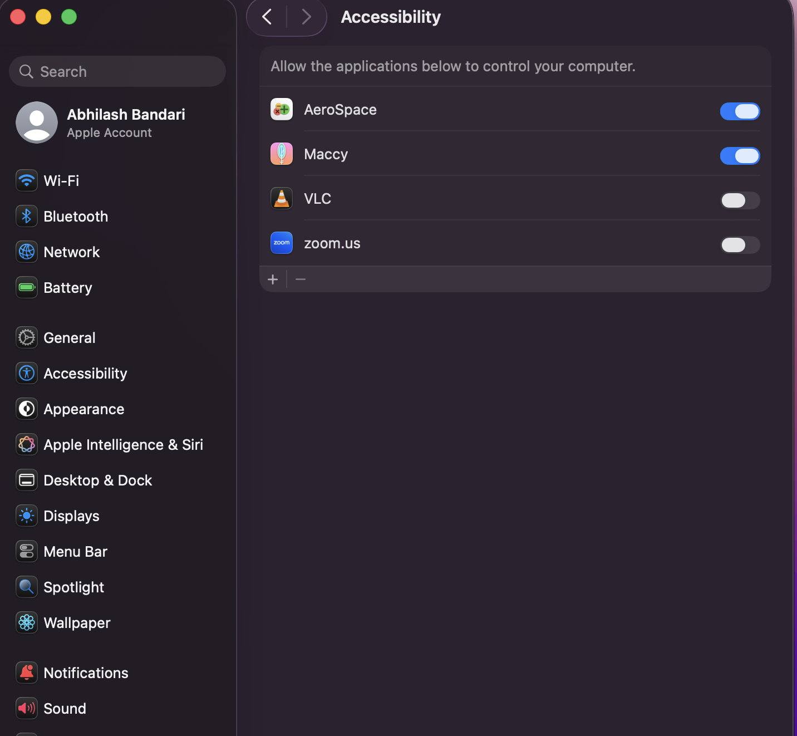
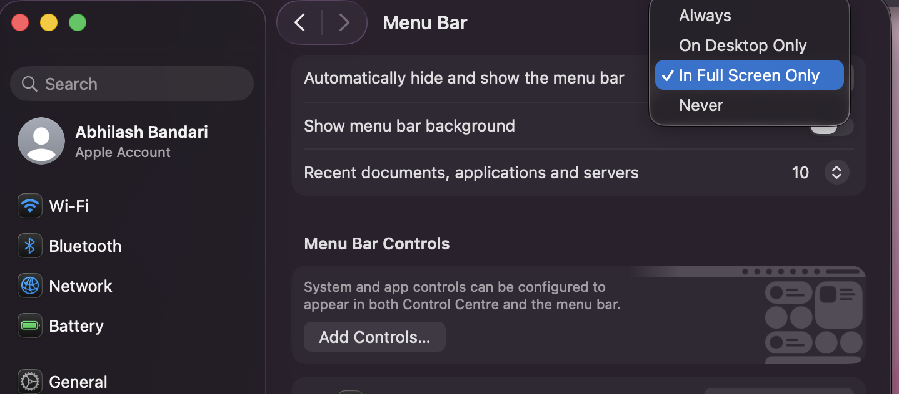

# macOS Dotfiles

My personal macOS setup — a tiling window manager, a custom status bar, and keyboard-driven everything. No mouse needed for 90% of what I do. If you've been wanting to clean up your mac workflow, this is a good starting point.

Built around [AeroSpace](https://github.com/nikitabobko/AeroSpace) and [SketchyBar](https://github.com/FelixKratz/SketchyBar). Managed with [GNU Stow](https://www.gnu.org/software/stow/) so everything stays version-controlled and portable.

---

## What's included

- **AeroSpace** — tiling window manager. Windows snap into a grid automatically. Switch workspaces and move windows around without touching the mouse.
- **SketchyBar** — replaces the default macOS menu bar with a floating, blurred bar that actually shows useful stuff (workspaces, Wi-Fi, battery, volume, current app).
- **App hotkeys** — launch your apps from the keyboard, handled by AeroSpace itself (no extra daemon).

---

## Requirements

- macOS 13 (Ventura) or newer — AeroSpace doesn't support older versions
- Any MacBook, Apple Silicon or Intel. External monitors work too.

---

## Installation

Clone it anywhere — the script detects its own location automatically:

```bash
git clone https://github.com/bandari-abhilash/dotfiles.git 
cd ~/dotfiles
chmod +x install.sh
./install.sh
```

> You can clone it to `~/dotfiles`, `~/Desktop/dotfiles`, or anywhere else — it doesn't matter.

The script will:
1. Install Homebrew if it's not already there
2. Tap `felixkratz/formulae` and `nikitabobko/tap`
3. Install `stow`, `jq`, `sketchybar`, and `aerospace`
4. Install Hack Nerd Font, the sketchybar-app-font, and its matching icon map
5. Symlink all configs into `~/.config` via GNU Stow
6. Start SketchyBar as a background service
7. Walk you through granting AeroSpace Accessibility permission
8. Tell you if your MacBook has no notch, since that needs a one-line gap tweak (see below)

If anything fails midway, the script rolls back everything it changed — no half-installed state left behind.

---

## Post-install: Permissions

AeroSpace needs Accessibility access to move windows and handle hotkeys. Go to **System Settings → Privacy & Security → Accessibility** and toggle AeroSpace on. It appears there automatically after first launch.



> **Upgrading from the skhd version?** Hotkeys now live in `aerospace.toml`. Re-running `./install.sh` stops skhd and removes its old config symlink. You can then `brew uninstall skhd` and remove it from the Accessibility list.

---

## Hiding the native menu bar

SketchyBar takes over the top of the screen, so hide the default macOS menu bar. Go to **System Settings → Menu Bar** (on older macOS: **Desktop & Dock → Menu Bar**) and set "Automatically hide and show the menu bar" to **Always**:



The window gaps in `aerospace.toml` assume this setting.

---

## Display compatibility (notch vs. no notch)

macOS reserves a strip at the top of notched MacBook screens (MacBook Air M2 and later, 14"/16" MacBook Pro 2021 and later), so windows there already start below most of the bar. The top gap is set per display:

```toml
outer.top = [{ monitor.'built-in' = 15 }, 47]   # built-in (notched) display, everything else
```

- **External monitors** use the second value (47 = 39pt bar + 8pt gap).
- **MacBooks without a notch** (M1 Air, 13" Pro, Intel models) should use `47` for the built-in value too. The installer tells you if this applies.

---

## Keybindings

### AeroSpace — Window & Workspace Management

| Shortcut | Action |
|----------|--------|
| `Alt + H/J/K/L` | Focus window left/down/up/right |
| `Alt + Shift + H/J/K/L` | Move window left/down/up/right |
| `Alt + 1–7` | Switch to workspace 1–7 |
| `Alt + Shift + 1–7` | Move window to workspace 1–7 |
| `Alt + /` | Toggle split orientation (horizontal ↔ vertical) |
| `Alt + ,` | Toggle accordion layout |
| `Alt + F` | macOS native fullscreen |
| `Alt + Shift + Space` | Toggle float/tile for current window |
| `Alt + Tab` | Jump to previous workspace |
| `Alt + Shift + Tab` | Move workspace to next monitor |
| `Alt + Shift + R` | Reload AeroSpace config |

### App Launchers & Quick Actions

| Shortcut | Action |
|----------|--------|
| `Alt + Return` | Open Terminal |
| `Alt + B` | Open Brave Browser |
| `Alt + A` | Open Arc |
| `Alt + C` | Open Cursor |
| `Alt + P` | Open Postman |
| `Alt + S` | Open Slack |
| `Alt + Shift + B` | Reload SketchyBar |

All hotkeys are defined in `aerospace/.config/aerospace/aerospace.toml`.

> **Non-US keyboard layouts:** on layouts like German or the Nordic ones, `Option + letter` types characters such as `@`, `[`, `|` and `~`. These bindings will swallow them. If that's you, change the `alt-` prefix to `ctrl-alt-` (or similar) for the keys you need for typing.

---

## App workspace assignments

Apps automatically land on their designated workspace when opened:

| App | Workspace |
|-----|-----------|
| Terminal | 1 |
| Arc | 2 |
| Brave | 3 |
| Slack | 4 |
| Postman | 7 |

Configure this in `aerospace/.config/aerospace/aerospace.toml` under the `[[on-window-detected]]` blocks at the bottom.

---

## Theming

There's a simple theme switcher that swaps both the SketchyBar color palette and the desktop wallpaper at once.

Available themes: `catppuccin` (Macchiato) and `tokyo-night`

```bash
./bin/set-theme tokyo-night
./bin/set-theme catppuccin
```

---

## Recording a demo

`demo/record-demo.sh` records a ~30 second mock incident: synthetic logs and metrics on workspace 1, a dashboard on 2, a runbook on 3. Each step shows its shortcut as a caption in SketchyBar and runs the matching AeroSpace command. It saves a `.mov` and a web-ready `.mp4`.

```bash
./demo/record-demo.sh                                   # saves to demo/out/
./demo/record-demo.sh ~/Desktop/workspace/portfolio/blog/assets
DASHBOARD_APP="Google Chrome" ./demo/record-demo.sh     # use a different browser
```

Everything on the recorded display is captured, so turn on Do Not Disturb and close private tabs first. Your terminal needs Screen Recording permission.

---

## How editing works (GNU Stow)

Every config file in this repo is symlinked into your `~/.config` folder. So `~/.config/aerospace/aerospace.toml` is just a pointer to the actual file inside `dotfiles/`.

**Always edit from the `dotfiles/` side** — that's what git tracks:

| Tool | Edit this file |
|------|----------------|
| AeroSpace | `aerospace/.config/aerospace/aerospace.toml` |
| SketchyBar | `sketchybar/.config/sketchybar/sketchybarrc` |

No need to re-run stow after editing. Changes take effect immediately (or after reloading the relevant service).

---

## Folder structure

```
dotfiles/
├── aerospace/
│   └── .config/
│       └── aerospace/
│           └── aerospace.toml        # Tiling layout, hotkeys, workspace rules
├── sketchybar/
│   └── .config/
│       └── sketchybar/
│           ├── sketchybarrc          # Bar entry point
│           ├── colors.sh             # Color palette
│           ├── icons.sh              # Nerd Font icon map
│           ├── items/                # Bar items (spaces, battery, wifi, etc.)
│           └── plugins/              # Scripts that power each item
├── themes/
│   ├── catppuccin.sh
│   ├── tokyo-night.sh
│   └── backgrounds/
│       └── tokyo-night.png
├── bin/
│   └── set-theme                     # Theme switcher script
├── demo/
│   ├── record-demo.sh                # Scripted screen recording for demos
│   └── fake-logs.sh                  # Synthetic incident logs and metrics
├── install.sh                        # One-click installer with rollback
└── uninstall.sh                      # Undoes install.sh
```

---

## Troubleshooting

### "No available formula" or "CommandLineTools" error during install
If the script fails with an error like `No available formula with the name` or explicitly hints at Xcode Command Line Tools, macOS is missing the required C-compiler to build SketchyBar.

Fix this by reinstalling the Xcode Command Line Tools:
```bash
sudo rm -rf /Library/Developer/CommandLineTools
sudo xcode-select --install
```
A prompt will appear — click **Install**. Once the download finishes, re-run `./install.sh`.
